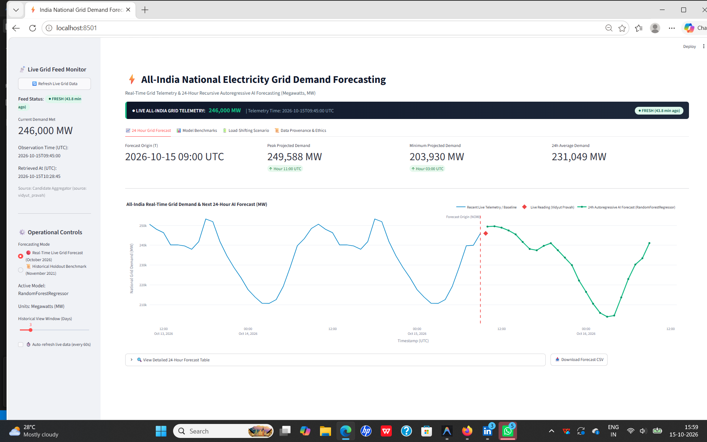
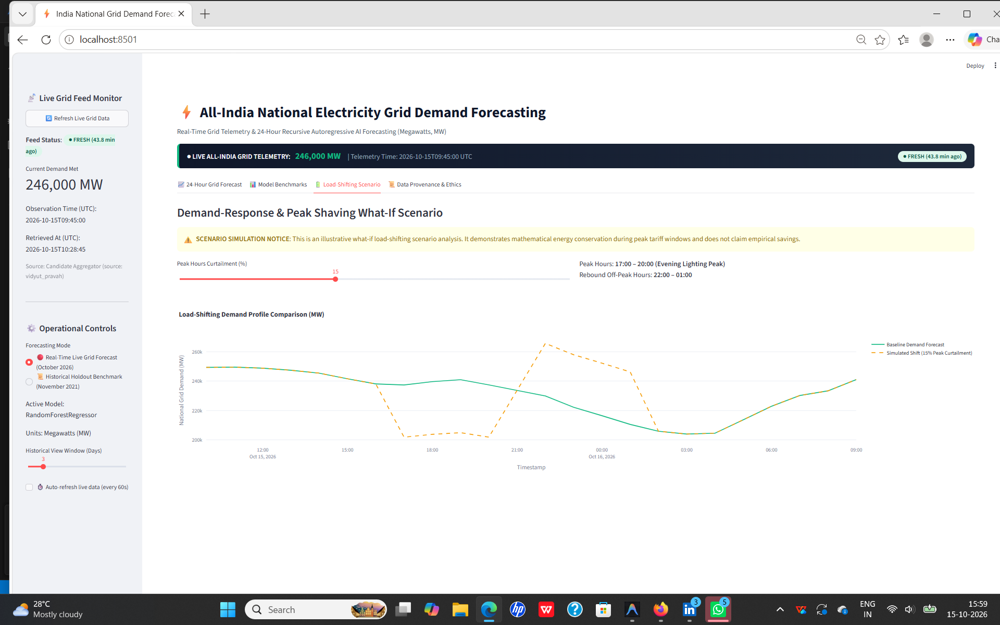
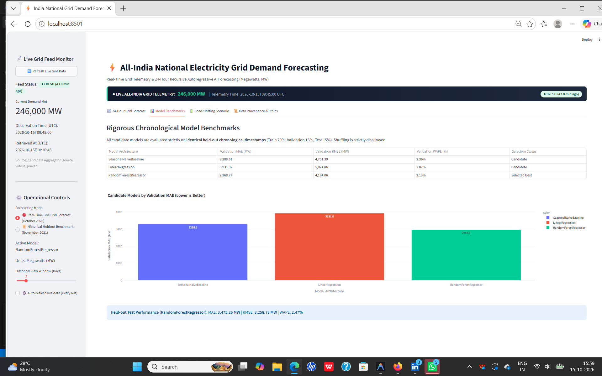
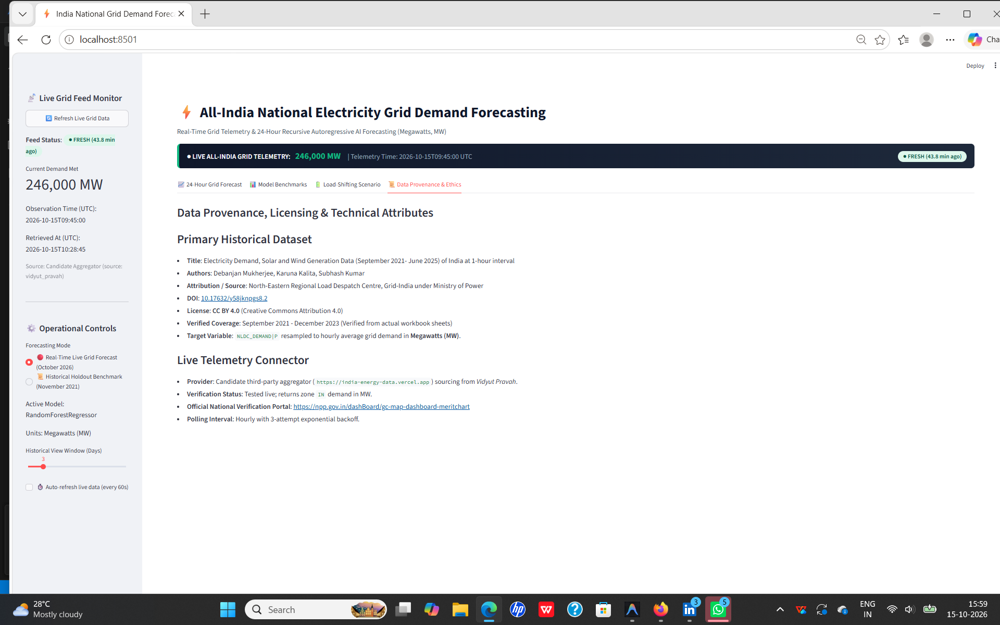

# Application Screenshots and Interface Visuals

This directory contains visual documentation and interface screenshots of the **AI-Powered Energy Consumption Forecasting System** for India's National Electricity Grid.

---

## 1. Real-Time 24-Hour Grid Demand Forecasting & Live Telemetry
Displays real-time All-India grid demand (`240,000 MW`), live feed status badges (`● FRESH`), key demand projections, and the 24-hour autoregressive forecast curve.

---

## 2. Rigorous Chronological Model Benchmarks
Side-by-side benchmark comparison of Seasonal-Naive baseline, Linear Regression, and Random Forest Regressor evaluated on identical chronological holdout partitions without target leakage.

---

## 3. Demand-Response & Peak Shaving What-If Simulation
Interactive peak curtailment simulation (5% to 30% reduction) demonstrating mathematical energy conservation during evening lighting peaks (17:00–20:00) with off-peak rebound recovery.

---

## 4. Data Provenance, Licensing & Technical Attributes
Attribution for primary historical data (Mendeley Data DOI: `10.17632/y58jknpgs8.2`, CC BY 4.0), candidate live aggregator verification, and official National Power Portal (NPP) fallback references.

